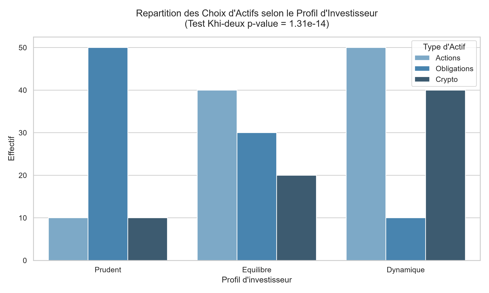

# Test d'Indépendance du Khi-deux (Chi2) appliqué à la Finance

Ce projet illustre l'application d'un **test non paramétrique du Khi-deux** pour déterminer s'il existe une dépendance entre le profil de risque d'un investisseur et le type d'actif financier qu'il privilégie.

## Visualisation des données

## Résultats du Test
- **Statistique Chi2 :** Calculée à partir du tableau de contingence.
- **p-value < 0.05 :** Rejet de H0 — Le profil d'investisseur influence significativement le choix d'actifs.

## Technologies
- **Python 3** (Pandas, SciPy, Matplotlib, Seaborn)